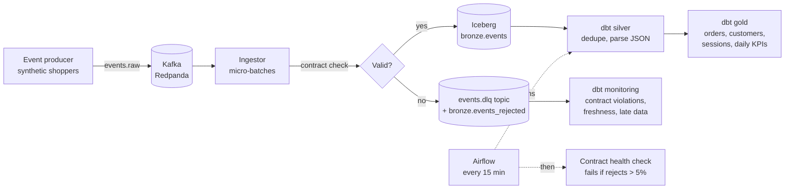

# Streaming Lakehouse

[](https://github.com/charan32/streaming-lakehouse/actions/workflows/ci.yml)

A real-time e-commerce lakehouse you can run on a laptop. Clickstream, cart, order and payment events stream through **Kafka**, are checked against **data contracts**, land in **Apache Iceberg** tables, and are modeled by **dbt** into business-ready tables on a schedule run by **Airflow**.

The data is synthetic, but it is deliberately messy the way real streams are: about 2% of events break their contract, 1% are duplicate sends, and 3% arrive late. The pipeline is built to handle all three.



## What it demonstrates

| Area | How it is done here |
|---|---|
| Streaming ingestion | Kafka consumer reads micro-batches (2,000 messages or 10 s) and commits each to Iceberg as one atomic snapshot. |
| Delivery guarantees | **At-least-once.** Kafka offsets are committed only after the Iceberg commit succeeds. Replays and producer retries are removed downstream by `event_id`. A test simulates a crash to prove it. |
| Data contracts | A versioned JSON Schema per event type ([`lakehouse/contracts`](lakehouse/contracts)). Bad events never reach bronze. They go to a dead-letter topic and an Iceberg table with a readable reason, such as `payload/unit_price: -3.5 is less than or equal to the minimum of 0`. |
| Open table format | Apache Iceberg via PyIceberg: schema with field docs, partitioned by event day, snapshot per batch, Postgres-backed catalog. |
| Modeling | dbt with bronze, silver and gold layers, a star schema (`fct_orders`, `fct_order_items`, `dim_customers`, `dim_products`), session funnel and daily KPIs. |
| Data quality | 26 dbt tests: keys, accepted values, relationships, plus business rules (order total equals its line items, payment equals order, funnel never widens). |
| Late and duplicate data | Event time and ingestion time are stored separately. `monitoring.pipeline_health` reports duplicates removed, p95 arrival delay and late events per day. |
| Orchestration | Airflow DAG: `dbt build` then a contract health check that fails the run when more than 5% of the last hour's events were rejected. |
| Testing and CI | 27 pytest tests, a full local pipeline run, and a GitHub Actions job that starts the Docker stack and checks data flows end to end. |

## Results from a local run

`make local` with 3,000 simulated sessions:

| Metric | Value |
|---|---|
| Events generated | 14,871 |
| Rejected by contracts | 305 (2.05%), each with a reason |
| Duplicates removed in silver | 155 |
| Late events (over 5 minutes) | 443 |
| dbt models and tests | 41 of 41 passed in about 3 seconds |
| Session to purchase conversion | 18.7% |

The top contract violations it caught: unknown event type `checkout_started` (103), missing `user_id` (85 on page views), invalid timestamps (64).

## Run it

### Option 1: the full streaming stack (Docker)

Requires Docker Desktop.

```bash
git clone https://github.com/charan32/streaming-lakehouse.git
cd streaming-lakehouse
docker compose up -d --build
```

| Service | URL |
|---|---|
| Redpanda Console: topics, live messages, dead letters, consumer lag | http://localhost:8080 |
| Airflow: the `lakehouse_gold` DAG | http://localhost:8081 |

The Airflow user is `admin`. Its password is generated on first start:

```bash
docker compose exec airflow cat /opt/airflow/standalone_admin_password.txt
```

Watch batches land in Iceberg, then read the gold tables after the DAG has run:

```bash
docker compose logs -f ingestor
docker compose exec airflow /opt/airflow/lakehouse-venv/bin/python -m lakehouse.report
```

Stop and delete everything with `docker compose down -v`.

### Option 2: local mode, no Docker

Runs the same contracts, Iceberg writer and dbt project, with the catalog in SQLite and files in `./.local`.

```bash
python -m venv .venv && source .venv/bin/activate
make install
make local          # generate -> validate -> Iceberg -> dbt build -> health check
python -m lakehouse.report
make test
```

## Project layout

```
lakehouse/
  generator.py      synthetic shoppers, with bad, duplicate and late events
  contracts/        JSON Schema contract per event type, plus the validator
  ingest.py         validate a batch and append it to Iceberg (no Kafka code)
  consume.py        Kafka consumer: batch, write, dead-letter, then commit offsets
  produce.py        Kafka producer (idempotent, keyed by user)
  health.py         contract health check used by Airflow
  report.py         prints KPIs and pipeline health
dbt/
  models/staging    silver: deduplicated, typed events per type
  models/marts      gold: star schema, sessions, daily KPIs
  models/monitoring contract violations and pipeline health
  tests/            business-rule tests
dags/               Airflow DAG
docker-compose.yml  Redpanda, Postgres catalog, producer, ingestor, Airflow
```

## Design decisions

- **Contracts at the door, not in the warehouse.** Rejecting at ingestion keeps bronze trustworthy, and the dead-letter record keeps the original message, so nothing is lost and the producing team can replay after a fix.
- **At-least-once plus dedupe instead of exactly-once.** Exactly-once across Kafka and an object store needs a transactional sink. Committing offsets after the Iceberg commit and deduplicating on `event_id` gives the same end result with far less machinery.
- **Ingestion code that does not know about Kafka.** `ingest.py` takes plain messages, so the same code is used by the consumer, the local mode and the tests.
- **Event time and ingestion time are both kept.** Daily numbers use event time. Freshness and lateness use the difference between the two.
- **Iceberg files on a local volume.** It keeps the stack small. Pointing `PYICEBERG_CATALOG__LAKEHOUSE__WAREHOUSE` at `s3://...` (with S3 credentials) moves it to object storage with no code changes.

## Roadmap

- Spark Structured Streaming as an alternative ingestion engine
- Iceberg table maintenance: compaction and snapshot expiry
- Incremental dbt models reading only new Iceberg snapshots
- Contract version 2 with a backward-compatible field, to show schema evolution
- An MCP server so an AI agent can query the lakehouse and diagnose failed runs
